<div align="center">


**Sistema de estudio de matemáticas organizado como línea de tiempo: de sumar y restar a los teoremas de Green, Stokes y Gauss. Se instala como app y funciona sin internet.**


[Parámetros](#1-parámetros-del-sistema) · [Rutas por curso](#2-rutas-de-aprendizaje-por-curso) · [Eras](#3-estructura-temporal-las-16-eras) · [Dependencias](#4-grafo-de-dependencias) · [Instalación](#8-instalación) · [Arquitectura](#10-arquitectura) · [English](#english)

</div>

---

## 0. Resumen

**Cálculo//** es una aplicación web para estudiar cálculo por temas, en el orden en que los conceptos dependen unos de otros. Empieza desde lo más básico —sumar, restar, multiplicar, fracciones, porcentajes— y sube por el álgebra, el precálculo, Cálculo I (diferencial), Cálculo II (integral) y Cálculo III (multivariable y vectorial): 70 secciones agrupadas en 16 eras. Cada era indica además el periodo histórico en que surgió la idea, de modo que el temario se lee también como una historia del cálculo.

Cada sección contiene teoría con el procedimiento completo, ejemplos resueltos paso a paso, una evaluación y referencias. Los términos técnicos funcionan como enlaces internos al estilo de una enciclopedia: muestran la definición formal y llevan a la teoría o a un ejemplo resuelto. Se usa en el navegador o se instala como app (PWA) con un clic, y funciona sin conexión.

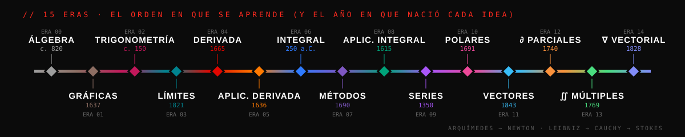

---

## 1. Parámetros del sistema

| Parámetro | Valor | Descripción |
|---|--:|---|
| Secciones | 70 | Unidades de estudio; 4 son evaluaciones integradoras (checkpoints) |
| Eras | 16 | Bloques temáticos ordenados por dependencia conceptual, de la aritmética al cálculo vectorial |
| Rutas de aprendizaje | 7 | Recorridos según el curso del estudiante (ver §2) |
| Ejemplos resueltos | 200 | Se revelan paso a paso con etapas *enunciado → dibujo → planteo → cálculo → respuesta* |
| Preguntas de evaluación | 450 | Opción múltiple con pista, explicación y, en cálculo integral, procedimiento completo |
| Términos de glosario | 111 | Enlaces internos con definición, fórmula, teoría, ejemplo y fuentes |
| Fuentes bibliográficas | 25 | Libros abiertos, cursos universitarios y obras históricas originales |
| Hitos históricos | 37 | Desde las tablillas babilónicas (c. 1800 a. C.) hasta las formas diferenciales (1945) |
| Simuladores | 11 | Práctica infinita de aritmética y álgebra (10 generadores con 3 niveles), graficación, regiones, áreas, sólidos de revolución, longitud de arco |
| Paletas de color | 8 + 1 | Cuatro claras, cuatro oscuras y un acento personalizable |
| Idiomas de interfaz | 2 | Español e inglés; contenido en español |
| Dependencias | 0 | HTML, CSS y JavaScript sin compilación; MathJax incluido en `vendor/` |
| Instalable | PWA | Se instala como app en Windows, macOS, Linux, Android e iOS y funciona sin internet (ver §8) |

---

## 2. Rutas de aprendizaje por curso

Al abrir la aplicación se ejecuta una secuencia de arranque y se pregunta qué curso está viendo el estudiante. Cada respuesta genera una ruta ordenada, con prerrequisitos, tiempo estimado y avance.

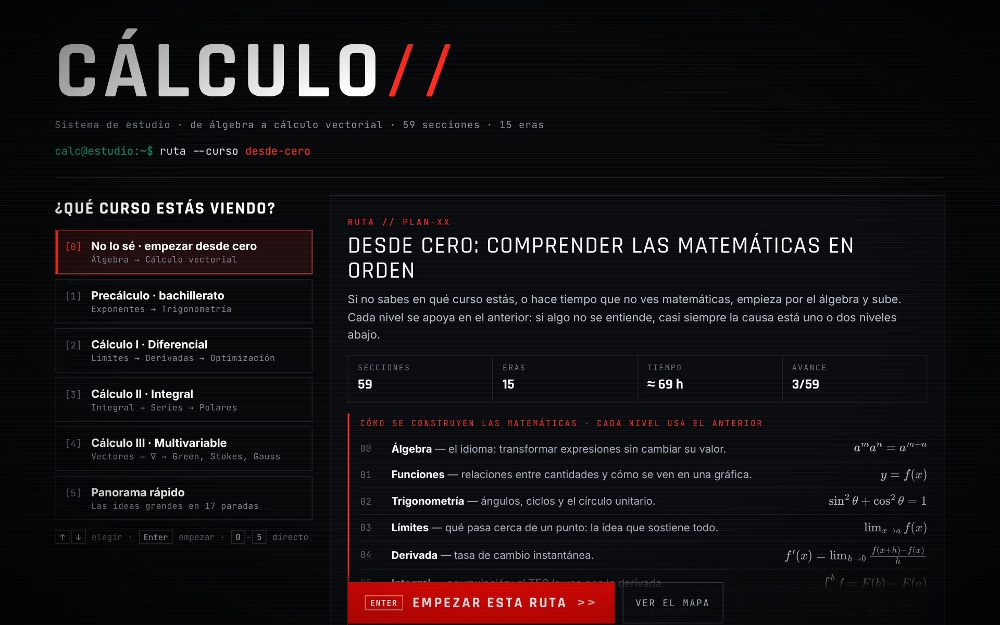

| Curso del estudiante | Plan | Recorrido | Secciones | Preguntas | Conviene dominar antes |
|---|:-:|---|--:|--:|---|
| **No lo sé / desde cero** | `PLAN-XX` | Sumar y restar → Teoremas de Stokes y Gauss | 70 | 450 | ninguno |
| **Matemática básica (primaria y bachillerato)** | `PLAN-A` | Números → Ecuaciones de primer grado | 11 | 90 | ninguno |
| **Precálculo (bachillerato)** | `PLAN-0` | Álgebra → Trigonometría | 7 | 51 | aritmética (`PLAN-A`) |
| **Cálculo I · diferencial** | `PLAN-I` | Álgebra → L’Hôpital | 18 | 118 | álgebra y funciones (incluidas en el plan) |
| **Cálculo II · integral** | `PLAN-II` | Integral indefinida → Coordenadas polares | 20 | 145 | límites, reglas de derivación, trigonometría |
| **Cálculo III · multivariable** | `PLAN-III` | Vectores → Teorema de la divergencia | 21 | 97 | derivadas, integral definida, paramétricas y polares |
| **Panorama / repaso** | `PLAN-E` | Límite → Gauss en 17 paradas | 17 | 97 | Cálculo I y II vistos al menos una vez |

### 2.1 Si no se conoce el curso: desde los números hacia arriba

La ruta *desde cero* sigue la estructura lógica de las matemáticas. Cada nivel supone el anterior; cuando algo no se entiende, la causa suele estar uno o dos niveles abajo.

| Nivel | Objeto | Pregunta que responde | Eras |
|:-:|---|---|:-:|
| 0 | Aritmética · $\frac23+\frac34=\frac{17}{12}$ | ¿Cómo opero con signos, fracciones, decimales y porcentajes? | 00 |
| 1 | Álgebra · $a^m a^n=a^{m+n}$ | ¿Cómo transformo una expresión sin cambiar su valor? | 01 |
| 2 | Funciones · $y=f(x)$ | ¿Cómo se relacionan dos cantidades y cómo se ve esa relación? | 02 |
| 3 | Trigonometría · $\sin^2\theta+\cos^2\theta=1$ | ¿Cómo se miden ángulos y fenómenos periódicos? | 03 |
| 4 | Límites · $\lim_{x\to a}f(x)$ | ¿Qué ocurre cerca de un punto, aunque no en el punto? | 04 |
| 5 | Derivada · $f'(x)$ | ¿Qué tan rápido cambia una cantidad en un instante? | 05–06 |
| 6 | Integral · $\int_a^b f\,dx$ | ¿Cuánto se acumula? ¿Qué relación tiene con la derivada? | 07–09 |
| 7 | Series · $\sum a_n$ | ¿Se puede sumar una cantidad infinita de términos? | 10–11 |
| 8 | Varias variables · $\nabla f$, $\iint$, $\oint$ | ¿Cómo se generaliza todo lo anterior al plano y al espacio? | 12–15 |

---

## 3. Estructura temporal: las 16 eras

El orden de las eras es **pedagógico**; la columna *Periodo* indica cuándo **surgió** cada idea. Históricamente la integral precede a la derivada en casi dos milenios, y el límite —que hoy fundamenta ambas— se formalizó al final, en el siglo XIX.

| Era | Tema | Objeto central | Periodo | Autores principales | Secc. | Ejemplos | Preguntas |
|:-:|---|---|---|---|--:|--:|--:|
| `00` | Aritmética y números | $\frac23+\frac34=\frac{17}{12}$ | c. 3000 a.C. – 1585 | Babilonios · Euclides · Brahmagupta · Stevin | 10 | 27 | 82 |
| `01` | Fundamentos algebraicos | $a^m a^n=a^{m+n}$ | c. 820 – 1637 | Al-Juarismi · Viète · Descartes | 4 | 12 | 31 |
| `02` | Funciones y gráficas | $y=f(x)$ | 1637 | Descartes · Fermat | 2 | 4 | 13 |
| `03` | Trigonometría | $\sin^2\theta+\cos^2\theta=1$ | c. 150 – 1748 | Ptolomeo · Euler | 1 | 2 | 7 |
| `04` | Límites y continuidad | $\lim_{x\to a}f(x)=L$ | 1821 – 1861 | Cauchy · Weierstrass | 3 | 10 | 19 |
| `05` | La derivada | $f'(x)=\lim_{h\to0}\frac{f(x+h)-f(x)}{h}$ | 1665 – 1684 | Newton · Leibniz | 3 | 8 | 19 |
| `06` | Aplicaciones de la derivada | $f'(c)=\frac{f(b)-f(a)}{b-a}$ | 1636 – 1696 | Fermat · Rolle · L’Hôpital | 6 | 13 | 37 |
| `07` | La integral | $\int_a^b f(x)\,dx=F(b)-F(a)$ | c. 250 a.C. – 1854 | Arquímedes · Barrow · Riemann | 2 | 10 | 16 |
| `08` | Métodos de integración | $\int u\,dv=uv-\int v\,du$ | 1690 – 1770 | Bernoulli · Euler | 6 | 22 | 44 |
| `09` | Aplicaciones de la integral | $V=\pi\int_a^b R(x)^2\,dx$ | 1615 – 1659 | Kepler · Cavalieri · Torricelli | 7 | 36 | 58 |
| `10` | Sucesiones y series | $\sum_{n\ge0}\frac{f^{(n)}(a)}{n!}(x-a)^n$ | c. 1350 – 1821 | Oresme · Taylor · Euler | 3 | 10 | 18 |
| `11` | Paramétricas y polares | $A=\frac12\int_\alpha^\beta r^2\,d\theta$ | 1658 – 1691 | Wren · Jakob Bernoulli | 2 | 4 | 9 |
| `12` | Vectores y el espacio | $\vec u\times\vec v\perp\vec u,\vec v$ | 1843 – 1881 | Hamilton · Grassmann · Gibbs | 3 | 6 | 15 |
| `13` | Derivadas en varias variables | $\nabla f=\lambda\nabla g$ | 1740 – 1788 | Clairaut · Euler · Lagrange | 6 | 13 | 27 |
| `14` | Integrales múltiples | $\iiint_E f\,dV$ | 1769 – 1841 | Euler · Lagrange · Jacobi | 5 | 11 | 20 |
| `15` | Cálculo vectorial | $\oint_{C}\vec F\cdot d\vec r=\iint_S(\nabla\times\vec F)\cdot d\vec S$ | 1813 – 1854 | Gauss · Green · Ostrogradski · Stokes | 7 | 12 | 35 |

### 3.1 Contenido por era

<details>
<summary><b>ERA 00 · Aritmética y números</b> — c. 3000 a.C. – 1585 — 10 secciones</summary>

| Código | Sección | Requiere |
|---|---|---|
| `SEC-00` | Los números y la recta numérica | — |
| `SEC-01` | Suma y resta (también con negativos) | `numeros` |
| `SEC-02` | Multiplicación y división | `suma-resta` |
| `SEC-03` | Orden de las operaciones | `mult-div` |
| `SEC-04` | Múltiplos, divisores, primos, MCM y MCD | `mult-div` |
| `SEC-05` | Fracciones desde cero | `primos` |
| `SEC-06` | Decimales y porcentajes | `fracciones-base` |
| `SEC-07` | Razones, proporciones y regla de tres | `decimales` |
| `SEC-08` | Potencias y raíces con números | `jerarquia`, `fracciones-base` |
| `SEC-X0` | Checkpoint: Aritmética | `potencias-base`, `proporciones` |

</details>
<details>
<summary><b>ERA 01 · Fundamentos algebraicos</b> — c. 820 – 1637 — 4 secciones</summary>

| Código | Sección | Requiere |
|---|---|---|
| `SEC-09` | El lenguaje del álgebra | `bossA` |
| `SEC-10` | Exponentes, radicales y fracciones | `algebra-intro`, `potencias-base` |
| `SEC-11` | Productos notables y factorización | `exponentes` |
| `SEC-12` | Fracciones, división, ecuaciones y logaritmos | `notables` |

</details>
<details>
<summary><b>ERA 02 · Funciones y gráficas</b> — 1637 — 2 secciones</summary>

| Código | Sección | Requiere |
|---|---|---|
| `SEC-13` | Graficar I: funciones básicas | `ecuaciones` |
| `SEC-14` | Graficar II: curvas especiales y regiones | `graficar` |

</details>
<details>
<summary><b>ERA 03 · Trigonometría</b> — c. 150 – 1748 — 1 secciones</summary>

| Código | Sección | Requiere |
|---|---|---|
| `SEC-15` | Trigonometría base | `ecuaciones` |

</details>
<details>
<summary><b>ERA 04 · Límites y continuidad</b> — 1821 – 1861 — 3 secciones</summary>

| Código | Sección | Requiere |
|---|---|---|
| `SEC-16` | Límites: la idea y sus leyes | `graficar` |
| `SEC-17` | Calcular límites: técnicas algebraicas | `limites`, `notables` |
| `SEC-18` | Continuidad y asíntotas | `limites-calc` |

</details>
<details>
<summary><b>ERA 05 · La derivada</b> — 1665 – 1684 — 3 secciones</summary>

| Código | Sección | Requiere |
|---|---|---|
| `SEC-19` | La derivada: definición y recta tangente | `limites-calc` |
| `SEC-20` | Reglas de derivación | `derivada-def`, `trigbase` |
| `SEC-21` | Derivación implícita, logarítmica e inversas | `derivadas` |

</details>
<details>
<summary><b>ERA 06 · Aplicaciones de la derivada</b> — 1636 – 1696 — 6 secciones</summary>

| Código | Sección | Requiere |
|---|---|---|
| `SEC-22` | Razones de cambio relacionadas | `implicita` |
| `SEC-23` | Aproximación lineal, diferenciales y método de Newton | `derivada-def` |
| `SEC-24` | Valor medio, crecimiento y trazado de curvas | `derivadas`, `continuidad` |
| `SEC-25` | Optimización | `tvm` |
| `SEC-26` | Regla de L'Hôpital | `implicita`, `limites-calc` |
| `SEC-X1` | Checkpoint: Cálculo diferencial | `lhopital`, `optimizacion` |

</details>
<details>
<summary><b>ERA 07 · La integral</b> — c. 250 a.C. – 1854 — 2 secciones</summary>

| Código | Sección | Requiere |
|---|---|---|
| `SEC-27` | Integral indefinida y sustitución u | `derivadas` |
| `SEC-28` | Integral definida y TFC | `basica`, `limites` |

</details>
<details>
<summary><b>ERA 08 · Métodos de integración</b> — 1690 – 1770 — 6 secciones</summary>

| Código | Sección | Requiere |
|---|---|---|
| `SEC-29` | Integración por partes | `definida` |
| `SEC-30` | Integrales trigonométricas | `partes`, `trigbase` |
| `SEC-31` | Completar el cuadrado | `notables`, `basica` |
| `SEC-32` | Sustitución trigonométrica | `cuadrado`, `potencias` |
| `SEC-33` | Fracciones parciales | `ecuaciones`, `cuadrado` |
| `SEC-34` | Integrales impropias | `definida`, `lhopital` |

</details>
<details>
<summary><b>ERA 09 · Aplicaciones de la integral</b> — 1615 – 1659 — 7 secciones</summary>

| Código | Sección | Requiere |
|---|---|---|
| `SEC-35` | Área entre curvas | `regiones`, `definida` |
| `SEC-36` | Discos y arandelas | `area` |
| `SEC-37` | Volúmenes por secciones transversales | `area`, `discos` |
| `SEC-38` | Cascarones cilíndricos | `discos` |
| `SEC-39` | Longitud de curva | `derivadas`, `notables`, `definida` |
| `SEC-40` | Superficie, trabajo y centro de masa | `longitud`, `discos` |
| `SEC-X2` | Checkpoint: Cálculo integral | `fracciones`, `trig`, `cascarones`, `longitud` |

</details>
<details>
<summary><b>ERA 10 · Sucesiones y series</b> — c. 1350 – 1821 — 3 secciones</summary>

| Código | Sección | Requiere |
|---|---|---|
| `SEC-41` | Sucesiones | `lhopital` |
| `SEC-42` | Series infinitas y criterios de convergencia | `sucesiones`, `impropias` |
| `SEC-43` | Series de potencias y de Taylor | `series` |

</details>
<details>
<summary><b>ERA 11 · Paramétricas y polares</b> — 1658 – 1691 — 2 secciones</summary>

| Código | Sección | Requiere |
|---|---|---|
| `SEC-44` | Curvas paramétricas | `implicita`, `longitud` |
| `SEC-45` | Coordenadas polares | `parametricas`, `trigbase` |

</details>
<details>
<summary><b>ERA 12 · Vectores y el espacio</b> — 1843 – 1881 — 3 secciones</summary>

| Código | Sección | Requiere |
|---|---|---|
| `SEC-46` | Vectores en el espacio | `trigbase` |
| `SEC-47` | Rectas, planos y superficies cuádricas | `vectores` |
| `SEC-48` | Funciones vectoriales y movimiento | `rectas-planos`, `parametricas` |

</details>
<details>
<summary><b>ERA 13 · Derivadas en varias variables</b> — 1740 – 1788 — 6 secciones</summary>

| Código | Sección | Requiere |
|---|---|---|
| `SEC-49` | Funciones de varias variables | `rectas-planos`, `continuidad` |
| `SEC-50` | Derivadas parciales | `varias`, `derivadas` |
| `SEC-51` | Plano tangente, diferencial y regla de la cadena | `parciales`, `linealizacion` |
| `SEC-52` | Gradiente y derivada direccional | `tangente`, `vectores` |
| `SEC-53` | Máximos y mínimos en varias variables | `gradiente`, `optimizacion` |
| `SEC-54` | Multiplicadores de Lagrange | `extremos` |

</details>
<details>
<summary><b>ERA 14 · Integrales múltiples</b> — 1769 – 1841 — 5 secciones</summary>

| Código | Sección | Requiere |
|---|---|---|
| `SEC-55` | Integrales dobles | `varias`, `area` |
| `SEC-56` | Integrales dobles en coordenadas polares | `dobles`, `polares` |
| `SEC-57` | Integrales triples | `dobles`, `rectas-planos` |
| `SEC-58` | Coordenadas cilíndricas y esféricas | `triples`, `dobles-polar` |
| `SEC-59` | Cambio de variables y jacobiano | `cilesf` |

</details>
<details>
<summary><b>ERA 15 · Cálculo vectorial</b> — 1813 – 1854 — 7 secciones</summary>

| Código | Sección | Requiere |
|---|---|---|
| `SEC-60` | Campos vectoriales, divergencia y rotacional | `gradiente`, `funvec` |
| `SEC-61` | Integrales de línea | `campos` |
| `SEC-62` | Teorema de Green | `linea`, `dobles` |
| `SEC-63` | Superficies paramétricas e integrales de superficie | `dobles-polar`, `campos` |
| `SEC-64` | Teorema de Stokes | `superficies`, `green` |
| `SEC-65` | Teorema de la divergencia (Gauss–Ostrogradski) | `superficies`, `triples` |
| `SEC-X3` | Evaluación final: Cálculo multivariable | `divergencia`, `stokes`, `lagrange` |

</details>

---

## 4. Grafo de dependencias

Una flecha $A\to B$ indica que $B$ usa resultados de $A$. Toda sección declara además sus prerrequisitos individuales (columna *Requiere* en §3.1).

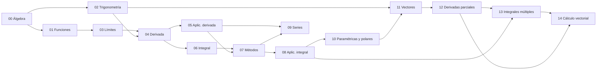

---

## 5. Estructura de una sección

| Componente | Contenido |
|---|---|
| Encabezado | Código (`SEC-xx`), era y periodo, prerrequisitos y dónde se usa el tema |
| Teoría | Motivación, definiciones, procedimiento numerado, error frecuente, observación, diagramas y tablas |
| Enlaces internos | Primera aparición de cada término del glosario; vista previa con definición, fórmula y fuentes |
| Citas | Referencias numeradas `[n]` y bibliografía al final de la sección |
| Ejemplos | Resolución paso a paso; cada paso puede enlazar a la ley que aplica |
| Simulador | En las secciones de graficación y aplicaciones de la integral |
| Evaluación | Preguntas con vidas, racha, pistas y puntos de experiencia; checkpoints cronometrados |

---

## 6. Módulos de la interfaz

| Módulo | Función |
|---|---|
| Arranque y selector de ruta | Secuencia de inicio y elección del curso; teclado: `↑` `↓` `Enter`, `Esc` para omitir |
| Mapa | La línea de tiempo del plan activo, con estado de cada sección |
| Línea de tiempo histórica | 32 hitos con autor, año, enlace a Wikipedia y a la sección correspondiente |
| Glosario | Índice alfabético con buscador |
| Hoja de apuntes | Resumen de cálculo integral por prioridad, exportable a PDF |
| Calculadora | Científica, con integral definida numérica, derivada en un punto y forma exacta |
| Pizarra | Superficie de escritura a mano con exportación a PNG |
| Modo TV y pantalla completa | Para proyección en clase |

---

## 7. Capturas

| Línea de tiempo | Enlaces internos |
|---|---|
| 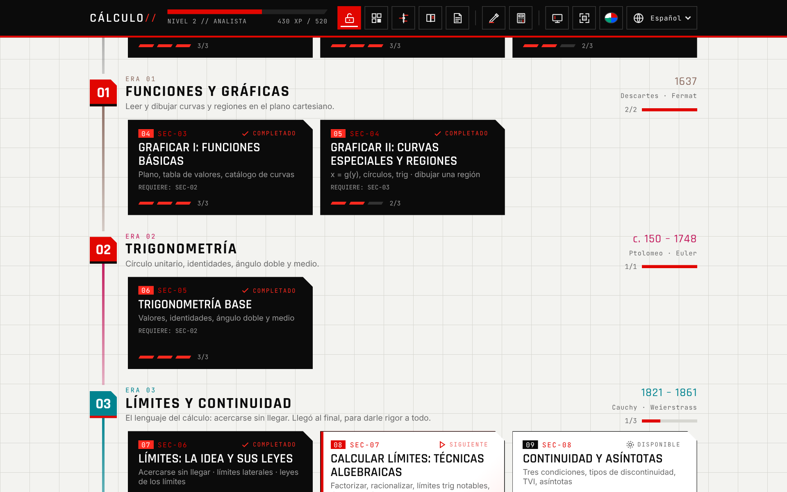 | 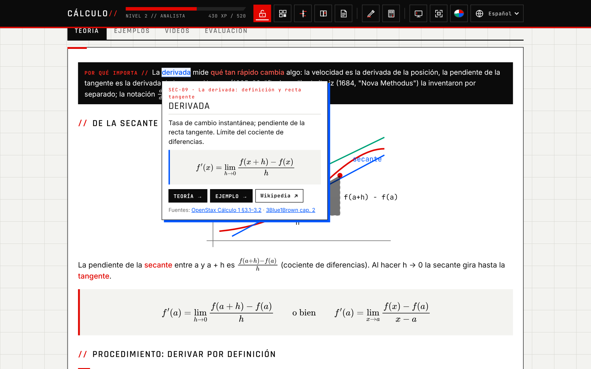 |
| **Historia** | **Paleta oscura** |
| 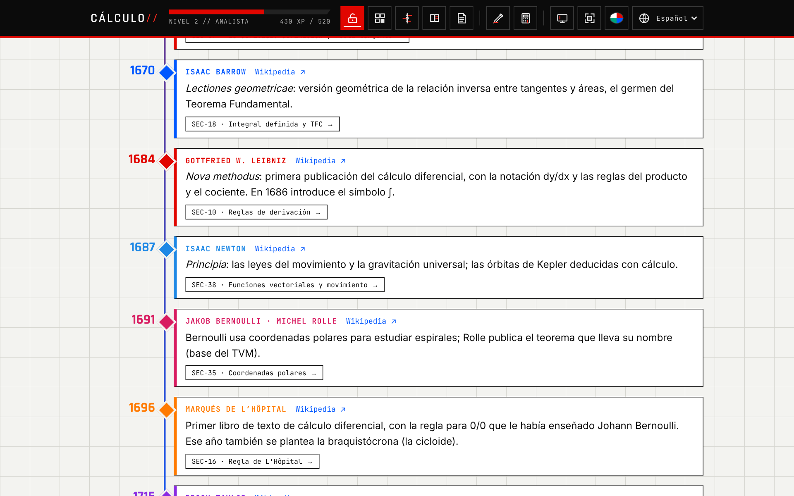 | 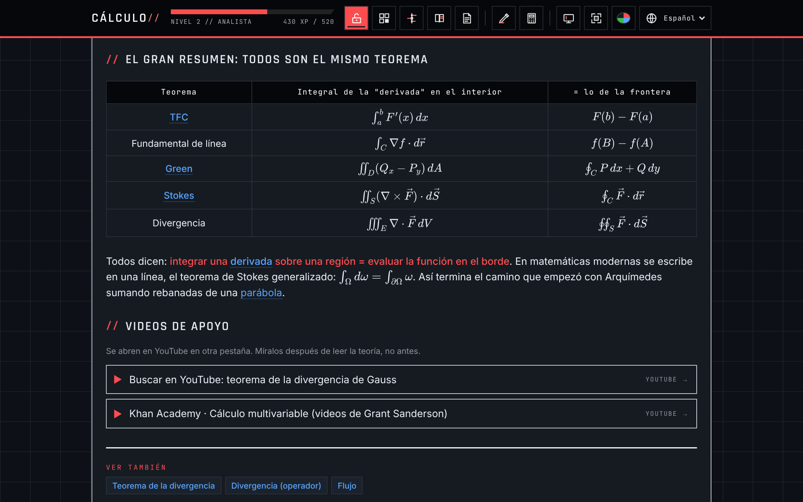 |
| **Arranque** | **Móvil** |
| 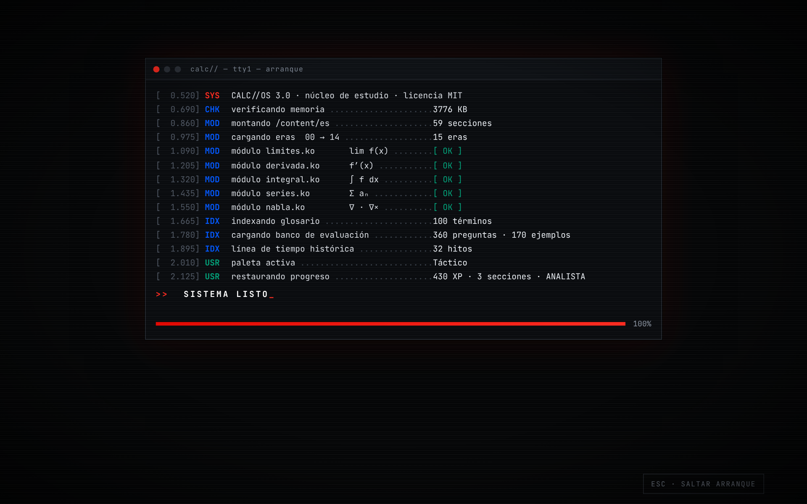 | 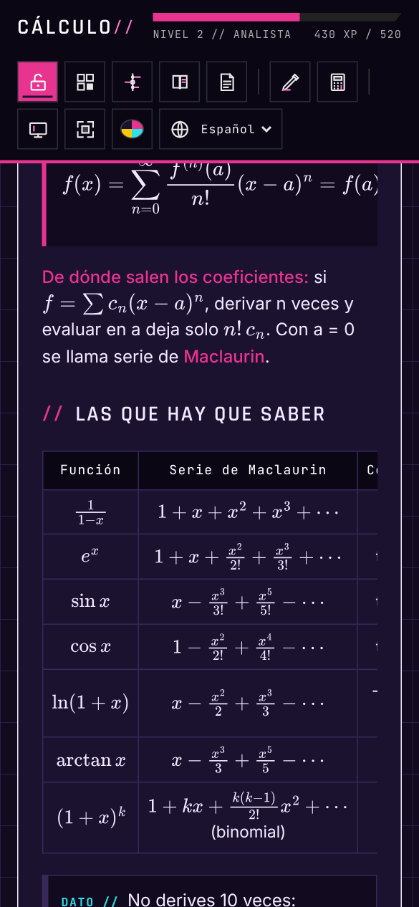 |

---

## 8. Instalación

### 8.1 Como app (recomendado)

La aplicación es una **PWA**: se instala desde el navegador en segundos, queda con su propio ícono y ventana, y **funciona sin internet** (todo, incluido MathJax, queda guardado en el equipo).

| Dispositivo | Cómo instalar |
|---|---|
| Windows / macOS / Linux (Chrome o Edge) | Abrir la página publicada y pulsar el botón **Instalar app** de la barra superior, o el ícono ⊕ de la barra de direcciones |
| Android (Chrome) | Menú ⋮ → **Instalar aplicación** |
| iPhone / iPad (Safari) | Botón Compartir → **Agregar a inicio** |

La forma más simple de tener una dirección para instalar es **GitHub Pages** (gratis): en el repositorio, *Settings → Pages → Build and deployment → Deploy from a branch → `main` / `(root)` → Save*. En un minuto queda en `https://tomikav.github.io/Calc-short-4-Calculator/`.

### 8.2 En el propio equipo

```bash
git clone https://github.com/tomikav/Calc-short-4-Calculator.git
cd Calc-short-4-Calculator
```

| Modo | Instrucción |
|---|---|
| Windows, doble clic | `abrir-app.bat`: levanta un servidor local y abre `http://localhost:8080` (desde ahí también se puede instalar) |
| Servidor local | `python -m http.server 8080` y abrir `http://localhost:8080` |
| Otro dispositivo en la red | Con el servidor anterior, abrir `http://IP-DEL-EQUIPO:8080` |
| Sin servidor | Abrir `index.html` directamente; funciona, pero así no se puede instalar ni usar sin conexión |
| Actualizar | `git pull`; la app instalada se actualiza sola al abrirla con conexión |

El progreso se guarda en el navegador (`localStorage`). Después de cambiar archivos, `python tools/precache.py` actualiza la lista de archivos que la app guarda para funcionar sin internet.

---|---|
| Local | Abrir `index.html` en el navegador (Windows: `start index.html`; macOS: `open`; Linux: `xdg-open`) |
| Servidor local | `python -m http.server 8080` y abrir `http://localhost:8080` |
| Otro dispositivo en la red | Con el servidor anterior, abrir `http://IP-DEL-EQUIPO:8080` |
| Como aplicación | Servido desde un servidor, Chrome o Edge ofrecen *Instalar aplicación* (manifiesto PWA incluido) |
| Actualizar | `git pull` y recargar con `Ctrl + F5` |

Requisitos: navegador reciente y conexión a internet al abrir (MathJax y tipografías se cargan desde la red). El progreso se guarda en el navegador (`localStorage`).

---

## 9. Personalización

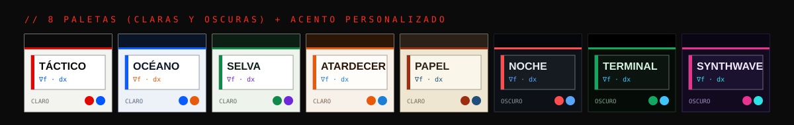

La interfaz completa depende de 12 variables CSS. Las paletas se eligen desde la barra superior; crear una nueva o llevar los colores a una aplicación nativa está documentado en [`docs/TEMAS.md`](docs/TEMAS.md).

---

## 10. Arquitectura

| Capa | Archivos | Responsabilidad |
|---|---|---|
| Motor | `js/app.js`, `core.js`, `i18n.js`, `loader.js` | Mapa, secciones, ejemplos, evaluación, estado |
| Arranque | `js/intro.js` | Secuencia de inicio y selector de ruta |
| Enlaces e historia | `js/wiki.js` | Glosario, vistas previas, citas, línea de tiempo histórica |
| Apariencia | `js/theme.js`, `css/style.css` | Paletas y estilos (variables CSS) |
| Herramientas | `js/fig.js`, `labs-*.js`, `calc.js`, `board.js`, `sketch.js` | Gráficas, simuladores, práctica infinita (`labs-basic.js`), calculadora, pizarra |
| App instalable | `manifest.webmanifest`, `sw.js`, `js/pwa.js`, `tools/precache.py` | Instalación, botón *Instalar app*, funcionamiento sin conexión |
| Terceros | `vendor/mathjax/` | MathJax 3 (Apache 2.0), incluido para funcionar sin internet |
| Contenido | `content/es/*.js` | Secciones, ejemplos, preguntas, glosario, fuentes |
| Ensamblado | `content/es/timeline.js` | Eras, orden, numeración `SEC-xx`, planes y rutas |

El motor no contiene contenido. Agregar una sección consiste en un `LV.push({...})` y una línea en `timeline.js`; la numeración y las referencias cruzadas se recalculan solas. El procedimiento está en [`CONTRIBUTING.md`](CONTRIBUTING.md).

---

## 11. Fuentes

| Fuente | Uso |
|---|---|
| Strang, Herman et al., *Cálculo* vol. 1–3, OpenStax (español) | Referencia principal de teoría, citada por capítulo |
| Dawkins, *Paul’s Online Math Notes*, Lamar University | Procedimientos y ejercicios |
| Stewart, *Cálculo de una variable* y *de varias variables*, Cengage | Referencia de ejemplos clásicos |
| MIT OpenCourseWare 18.01SC y 18.02SC | Estructura de Cálculo I y III |
| 3Blue1Brown, *Essence of Calculus*; Khan Academy (aritmética, preálgebra y cálculo) | Material audiovisual complementario |
| Obras originales: Arquímedes, Leibniz (1684), L’Hôpital (1696), Taylor (1715), Green (1828), Stokes (1854) | Hitos históricos |

---

## 12. Contribuciones y licencia

Las contribuciones (secciones, ejemplos, preguntas, términos, hitos, paletas o traducciones) siguen [`CONTRIBUTING.md`](CONTRIBUTING.md). Dentro de la teoría se enlaza con `[[clave]]` y se cita con `[^fuente|§2.3]`.

Licencia [MIT](LICENSE). Los ejercicios de taller se citan con fines educativos; las fuentes enlazadas pertenecen a sus autores.

---

<a id="english"></a>

## English

**Cálculo//** is an installable web app (PWA, works offline) for learning mathematics in order, from adding and subtracting to the theorems of Green, Stokes and Gauss: 70 sections in 16 eras covering arithmetic, algebra, precalculus and Calculus I–III, with 200 worked examples, 450 quiz questions, endless practice generators for arithmetic and algebra, 111 cross-linked glossary terms, numbered citations and 37 historical milestones. On start-up it runs a boot sequence and asks which course the student is taking, then builds an ordered learning path; students who do not know start from numbers. Eight colour palettes are driven by 12 CSS variables. Open the published page and click **Install app**, or clone the repository and run `abrir-app.bat` (Windows) or `python -m http.server`. The interface is available in Spanish and English; course content is in Spanish.
