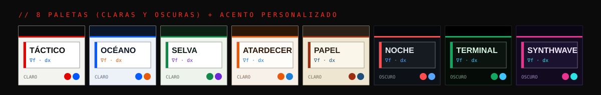

# Paletas de color y design tokens

Toda la interfaz se pinta con **12 variables CSS**. Una paleta es solo un conjunto de valores para esas variables, así que cambiar el look completo (o llevarlo a una app nativa) no requiere tocar el CSS.



## Los tokens

| Token | Uso | Táctico (por defecto) |
|---|---|---|
| `--bg` | fondo de la página (la cuadrícula se dibuja con `--line`) | `#f3f3f0` |
| `--paper` | tarjetas y paneles de teoría | `#ffffff` |
| `--soft` | fondos suaves (filas, inputs) | `#fafaf8` |
| `--ink` | texto principal y bordes fuertes | `#0b0b0b` |
| `--ink2` | texto secundario | `#333333` |
| `--mut` | texto apagado, ayudas | `#6b6b6b` |
| `--line` | líneas finas, cuadrícula | `#d6d6d0` |
| `--hud` | barra superior y bloques oscuros (siempre con texto blanco) | `#0b0b0b` |
| `--red` | **acento principal** (botones, títulos, progreso) | `#e10600` |
| `--red2` | acento brillante (logo, brillos) | `#ff2a1f` |
| `--blue` | acento secundario y **enlaces tipo Wikipedia** | `#0057ff` |
| `--green` | correcto / completado | `#00a37a` |

Los tintes (`--tint-red`, `--tint-blue`, `--tint-green`) se calculan solos con `color-mix()` a partir del acento y `--paper`.

> Los nombres `--red` y `--blue` se conservan por compatibilidad: en la paleta Océano `--red` es azul. Piensa en ellos como *primario* y *secundario*.

## Crear una paleta

En [`js/theme.js`](../js/theme.js), copia un bloque de `PALETTES`:

```js
miPaleta: { name:'Mi paleta', scheme:'light', vars:{
  bg:'#f3f3f0', paper:'#ffffff', soft:'#fafaf8', ink:'#0b0b0b', ink2:'#333333', mut:'#6b6b6b',
  line:'#d6d6d0', hud:'#0b0b0b', red:'#e10600', red2:'#ff2a1f', blue:'#0057ff', green:'#00a37a' } },
```

- `scheme:'dark'` hace que las gráficas (SVG y lienzos de los simuladores) se muestren sobre una tarjeta clara, porque se dibujan con trazo negro.
- Revisa el contraste: el texto sobre `--red` y `--hud` es blanco.
- Aparece sola en el selector (botón de colores en la barra superior). La elección se guarda en el navegador (`localStorage['calc-theme']`).

## Llevarlo a una app

Los mismos 12 tokens sirven tal cual como tema:

```js
// React Native / Expo
export const theme = { bg:'#f3f3f0', paper:'#ffffff', ink:'#0b0b0b', primary:'#e10600', secondary:'#0057ff', success:'#00a37a', /* ... */ };
```

```dart
// Flutter
ColorScheme.light(primary: Color(0xFFE10600), secondary: Color(0xFF0057FF), surface: Color(0xFFFFFFFF), onSurface: Color(0xFF0B0B0B));
```

El proyecto ya incluye `manifest.webmanifest`, así que en Chrome/Edge (servido desde un servidor, no con doble clic) se puede **instalar como app** desde el ícono de la barra de direcciones. El siguiente paso natural sería un *service worker* para que funcione sin conexión, o empaquetarlo con Capacitor/Tauri.
